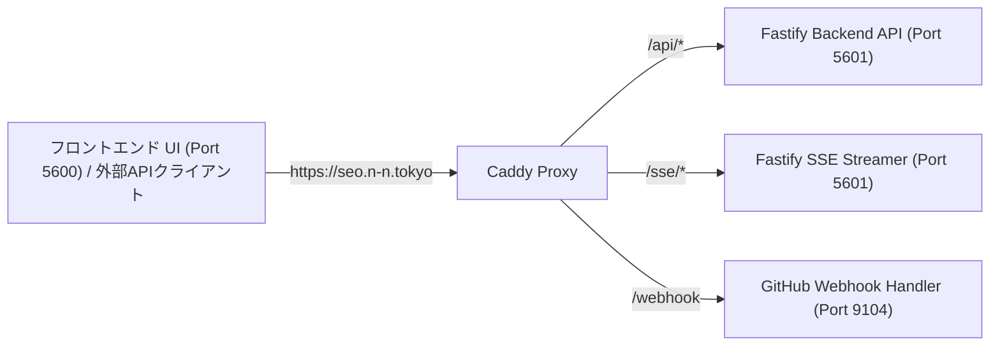

# 04. API詳細仕様書 (API SPECIFICATION)

> **プロジェクト名称**: SEO Analyzer  
> **ドキュメント種別**: 詳細設計書（REST API・SSEリアルタイム通信・型定義・エラーハンドリング）  
> **バックエンド基幹ポート**: `127.0.0.1:5601` (Fastify / Node.js 22 LTS)  
> **ベースURL**: `/api/v1` (SSEストリーム: `/sse/*`)  
> **版数**: 2.2.0 (バックエンド/フロントエンド分離 & Webhook自動デプロイ対応版)

---

## 1. サービスポート & ルーティング仕様

本システムのAPI群は、独立したバックエンドプロセス（`seo-backend` / ポート `5601`）によって高速処理されます。Caddyにより、外部クライアントからは同一ドメイン（`https://seo.n-n.tokyo/api/*` および `https://seo.n-n.tokyo/sse/*`）として透過的に利用できます。



---

## 2. エンドポイント完全マトリクス

### ① 診断 & メタ不具合 & AI表示 (Audits & Meta Inspector)
| メソッド | パス | 説明 | 認証 |
|---|---|---|---|
| `POST` | `/api/v1/audit/quick` | 単一URL即時診断開始（Job発行） | 任意 (Rate Limit有) |
| `GET` | `/sse/audit/:jobId` | SSEリアルタイム診断進捗ストリーミング | 不要 |
| `GET` | `/api/v1/audit/results/:id` | 診断総合スコア・全課題サマリー取得 | 任意 |
| `GET` | `/api/v1/audit/:id/meta-defects`| **メタタグ不具合・重複・文字化け詳細一覧** | 任意 |
| `GET` | `/api/v1/audit/:id/dom-diff` | **Raw HTML vs Rendered DOM 差分解析結果** | 任意 |
| `GET` | `/api/v1/audit/:id/ai-preview` | **Google AI Overviews / Perplexity プレビュー再現** | 任意 |
| `GET` | `/api/v1/audit/:id/proposals` | **具体的修正案・Before/Afterコード一覧** | 任意 |

### ② ディープクロール & リンクグラフ (Crawler & Graph)
| メソッド | パス | 説明 | 認証 |
|---|---|---|---|
| `POST` | `/api/v1/crawl/start` | サイト全体ディープクロールセッションの開始 | 必須 |
| `POST` | `/api/v1/crawl/:sessionId/pause` | クロールの一時停止（チェックポイント保存） | 必須 |
| `POST` | `/api/v1/crawl/:sessionId/resume`| 中断されたクロールセッションの再開 | 必須 |
| `GET` | `/sse/crawl/:sessionId` | クロール進捗リアルタイムストリーム | 必須 |
| `GET` | `/api/v1/crawl/:sessionId/status`| 巡回進捗・処理ページ数・404件数 | 必須 |
| `GET` | `/api/v1/crawl/:sessionId/graph` | **D3.js用 内部リンク有向グラフ (Nodes / Edges)** | 必須 |
| `GET` | `/api/v1/crawl/:sessionId/broken`| リンク切れ（404/500）およびリンク元一覧 | 必須 |
| `GET` | `/api/v1/crawl/:sessionId/tree`  | サイト構造階層ツリー (階層別URL一覧) | 必須 |
| `GET` | `/api/v1/crawl/:sessionId/clusters`| トピッククラスター分析 & 内部リンク構造サマリー | 必須 |
| `POST` | `/api/v1/crawl/links` | **単一URLからの即時内部リンク抽出 & クラスター解析** | 任意 |

### ③ プロジェクト管理 & 履歴差分 (Projects & Time-Travel Diff)
| メソッド | パス | 説明 | 認証 |
|---|---|---|---|
| `GET` | `/api/v1/projects` | ログイン中ユーザーが所有するプロジェクト一覧取得（未ログイン時は空配列返却） | 任意 (Bearer) |
| `POST` | `/api/v1/projects` | ログイン中アカウントに紐付いた新規プロジェクト登録 | **必須 (Bearer)** |
| `PUT` | `/api/v1/projects/:id` | **プロジェクト名・監視ルートURLの編集** | **必須 (所有者Bearerのみ)** |
| `DELETE` | `/api/v1/projects/:id` | **プロジェクトおよび関連履歴の完全削除** | **必須 (所有者Bearerのみ)** |
| `GET` | `/api/v1/projects/:id/history` | スコア・Core Web Vitalsの日次推移データ | **必須 (所有者Bearerのみ)** |
| `GET` | `/api/v1/projects/:id/diff` | **前回診断とのメタタグ・スコア変動差分比較** | **必須 (所有者Bearerのみ)** |
| `POST` | `/api/v1/projects/:id/notify/test`| Slack / Webhook テスト通知送信 | **必須 (所有者Bearerのみ)** |
| `GET` | `/api/v1/projects/:id/google-settings` | プロジェクト固有のGoogle API認証設定取得 | **必須 (所有者Bearerのみ)** |
| `POST` | `/api/v1/projects/:id/google-settings` | プロジェクト固有のGoogle API設定（キー・プロパティID）登録/更新 | **必須 (所有者Bearerのみ)** |

### ④ Google公式API連携 (Google Official Integrations)
| メソッド | パス | 説明 | 認証 |
|---|---|---|---|
| `GET` | `/api/v1/integrations/google/auth-url` | Google OAuth2 認証開始URL取得（ブラウザ別セッション開始） | 不要 |
| `GET` | `/api/v1/integrations/google/callback` | OAuth2 コールバック処理 & 暗号化セッショントークン発行 | 不要 |
| `GET` | `/api/v1/integrations/google/session` | 現在のブラウザのGoogle連携ステータス照会 | セッションID |
| `POST` | `/api/v1/integrations/google/disconnect`| 現在のブラウザのGoogle連携解除 & トークン完全破棄 | セッションID |
| `POST` | `/api/v1/google/hub-data` | **PSI・CrUX・GSC・GA4・Gemini 統合データ & GSC SEO機会一括照会** | 任意 (未連携時は未取得表示) |
| `POST` | `/api/v1/integrations/google/service-account` | サービスアカウントJSONキーの登録 | 必須 |
| `POST` | `/api/v1/google/inspect` | **GSC URL Inspection API 即時照会** | セッションID |
| `POST` | `/api/v1/google/index-publish` | **Google Indexing API 即時巡回通知** | セッションID |

### ⑤ ツール & セキュリティ & エクスポート (Tools & Security & Reports)
| メソッド | パス | 説明 | 認証 |
|---|---|---|---|
| `POST` | `/api/v1/tools/security-review` | **公開サイトのパッシブ・セキュリティレビュー（SSRF保護付き）** | 任意 (Rate Limit有) |
| `POST` | `/api/v1/tools/validate-sitemap` | **XMLサイトマップ構文・URL・カノニカル整合性検証** | 任意 |
| `POST` | `/api/v1/tools/generate-llms-txt` | 対象サイトの構造から `llms.txt` を自動合成 | 任意 |
| `GET` | `/api/v1/audit/results/:id/pdf` | ホワイトラベルPDFレポートのバイナリ出力 | 任意 |
| `GET` | `/api/v1/reports/:auditId/pdf` | PDFレポート出力エイリアス | 任意 |
| `GET` | `/api/health` | バックエンド死活監視エンドポイント (200 OK) | 不要 |

### ⑥ 設定・通知・チーム管理 (Settings & Team)
| メソッド | パス | 説明 | 認証 |
|---|---|---|---|
| `GET` | `/api/v1/settings/alerts` | メール/Slack通知設定の取得 | 必須 (Bearer) |
| `POST` | `/api/v1/settings/alerts` | メール/Slack通知設定の更新 | 必須 (Bearer) |
| `POST` | `/api/v1/settings/alerts/test` | 汎用アラートテスト通知の送信 | 必須 (Bearer) |
| `GET` | `/api/v1/settings/api-keys` | 発行済み外部APIキー一覧 | 必須 (Bearer) |
| `POST` | `/api/v1/settings/api-keys` | 新規外部APIキーの発行 | 必須 (Bearer) |
| `DELETE` | `/api/v1/settings/api-keys/:id` | 外部APIキーの無効化・削除 | 必須 (Bearer) |
| `GET` | `/api/v1/team/members` | 組織内チームメンバー一覧取得 | 必須 (Bearer) |
| `POST` | `/api/v1/team/members` | チームメンバー招待メール送信 | 必須 (Bearer) |
| `DELETE` | `/api/v1/team/members/:id` | チームメンバー除名 | 必須 (Bearer) |

### ⑦ ユーザー認証 & セッション (Authentication & Users)
| メソッド | パス | 説明 | 認証 |
|---|---|---|---|
| `POST` | `/api/v1/auth/register` | メール＋パスワードによる新規ユーザー登録（認証コード発行） | 不要 |
| `POST` | `/api/v1/auth/login` | メール＋パスワードによるログイン認証 | 不要 |
| `GET` | `/api/v1/auth/google/url` | Googleログイン用OAuth認証URL発行 | 不要 |
| `POST` | `/api/v1/auth/google/callback` | Googleログイン認証コード検証 & ログイン完了（自動認証済） | 不要 |
| `GET` | `/api/v1/auth/me` | 現在のログインユーザー情報（認証状態・権限）取得 | 必須 (Bearer/Cookie) |
| `PUT` | `/api/v1/auth/profile` | アカウントプロファイル（表示名）更新 | **必須 (Bearer)** |
| `PUT` | `/api/v1/auth/email` | メールアドレス変更申請（認証コード再発行・未認証化） | **必須 (Bearer)** |
| `POST` | `/api/v1/auth/verify-email` | 6桁の認証コード検証 & メール認証完了 | **必須 (Bearer)** |
| `POST` | `/api/v1/auth/resend-verification` | 認証コードの再発行・再送信 | **必須 (Bearer)** |
| `PUT` | `/api/v1/auth/password` | パスワード変更（旧パスワード照合 & 暗号化保存） | **必須 (Bearer)** |
| `POST` | `/api/v1/auth/logout` | セッショントークンの破棄・ログアウト | 必須 |

### ⑧ プラットフォーム管理者専用API (Platform Administration - SCR-30)
| メソッド | パス | 説明 | 認証 |
|---|---|---|---|
| `GET` | `/api/v1/admin/stats` | システム全体統計（ユーザー数、プロジェクト数、診断実行数、APIキー稼働状況） | **必須 (ADMIN Bearer)** |
| `GET` | `/api/v1/admin/users` | 全登録ユーザー一覧取得（メール認証状態、プロバイダ、ロール等） | **必須 (ADMIN Bearer)** |
| `PUT` | `/api/v1/admin/users/:id/role` | ユーザーのロール変更（ADMIN / MEMBER） | **必須 (ADMIN Bearer)** |
| `GET` | `/api/v1/admin/projects` | システム内の全プロジェクト一覧監視 | **必須 (ADMIN Bearer)** |

### ⑨ インフラ・自動デプロイ (Webhook)
| メソッド | パス | 説明 | 認証 |
|---|---|---|---|
| `POST` | `/webhook` | GitHub Push イベント受信 & ゼロダウンタイムデプロイキック | HMAC-SHA256署名 |
| `GET` | `/webhook/health` | Webhookサーバー死活監視 | 不要 |

---

## 3. 主要API詳細仕様

### 3.1 公開サイト・パッシブセキュリティレビュー (`POST /api/v1/tools/security-review`)

外部公開URLに対して非侵入型のパッシブ・セキュリティ診断を実施し、セキュリティヘッダー、Cookie属性、暗号化通信状態、露出情報を評価します。

#### リクエスト
- **メソッド**: `POST`
- **Content-Type**: `application/json`
- **ボディ**:
```json
{
  "url": "https://example.com"
}
```

#### セキュリティ保護規約 (SSRF対策)
- `http:` または `https:` スキームのみ許可
- IP直接指定、プライベートIP範囲（`10.0.0.0/8`, `172.16.0.0/12`, `192.168.0.0/16`, `127.0.0.0/8` 等）、リンクローカルアドレス（`169.254.169.254` などのクラウドメタデータ）へのアクセスを完全遮断
- DNS名前解決によるIP検証を行い、DNSリバインディング攻撃を遮断
- リダイレクト追従は最大3回までとし、リダイレクト先URLごとにもSSRF検査を実施

#### レスポンス (200 OK)
```json
{
  "url": "https://example.com",
  "analyzedAt": "2026-10-14T12:00:00.000Z",
  "score": 85,
  "grade": "B",
  "summary": {
    "critical": 0,
    "high": 1,
    "medium": 2,
    "low": 1,
    "info": 0
  },
  "findings": [
    {
      "id": "SEC-CSP-001",
      "severity": "high",
      "title": "Content-Security-Policy (CSP) 未設定",
      "description": "CSPヘッダーが設定されていないため、クロスサイトスクリプティング (XSS) や不正なリソース読み込みのリスクが高まります。",
      "recommendation": "default-src 'self' を基本としたContent-Security-Policyヘッダーを設定してください。"
    }
  ]
}
```
